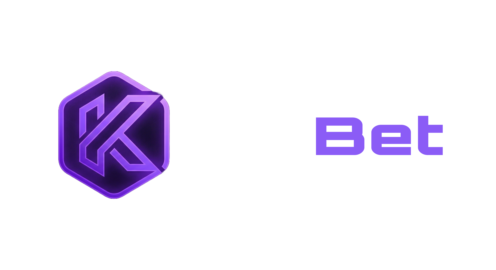

<p align="center">
	
</p>

# Krabets Frontend

Krabets Frontend is the production user interface for the Krabets platform. It is a Next.js application that powers the public site, authentication flows, dashboard experience, wallet screens, game pages, settings, and frontend API integration.

The app is designed to work with the separate backend service deployed on Railway. The frontend consumes the backend through `NEXT_PUBLIC_API_BASE_URL` and is already configured for Vercel deployment.

## What this app does

- Presents the public landing experience and platform entry points
- Handles authentication, onboarding, and 2FA verification screens
- Renders dashboard pages for games, wallet, VIP, chat, settings, and search
- Connects to backend APIs for balances, notifications, wallet actions, and user state
- Supports realtime UI behavior where the backend provides websocket-driven updates

## Architecture

This frontend follows a feature-based Next.js structure:

- `src/app` contains route segments, layouts, and app-level pages
- `src/features` contains feature modules such as auth, wallet, dashboard, games, chat, and notifications
- `src/shared` contains reusable config, hooks, UI components, API helpers, utilities, and i18n

The app uses the Next.js App Router and keeps UI responsibilities separated by feature rather than by technical layer.

### Main route areas

- `src/app/page.tsx` landing page
- `src/app/auth/*` auth and onboarding routes
- `src/app/dashboard/*` core player dashboard routes
- `src/app/api/media/*` frontend API helpers and media-related routes

### Feature modules

- `src/features/auth` login, signup, password reset, and verification flows
- `src/features/wallet` wallet overview, deposits, withdrawals, and transaction UI
- `src/features/dashboard` dashboard shell, navigation, and page composition
- `src/features/chat` chat UI and live interaction surfaces
- `src/features/coinflip`, `src/features/dice`, `src/features/crash`, `src/features/limbo`, `src/features/mines` game-specific pages and components
- `src/features/notifications` notification UI and list handling
- `src/features/settings` account and preference screens
- `src/features/search` search experience

### Shared layer

- `src/shared/config` central runtime configuration and environment access
- `src/shared/api` API client helpers
- `src/shared/hooks` reusable hooks for auth, wallet, session, and live data
- `src/shared/ui` common UI components and primitives
- `src/shared/utils` formatting, parsing, and helper utilities
- `src/shared/i18n` translations and language helpers

## How it works

1. The app starts in Next.js and renders the route from `src/app`
2. Shared config loads frontend environment values such as API base URL and public app URL
3. Feature pages call the backend through the centralized API layer
4. Auth state and session information are stored and reused by shared hooks
5. Wallet and dashboard pages refresh data from the backend after user actions
6. Realtime and media-related interactions are handled through feature-specific hooks and routes

## Project structure

```text
krabets-frontend/
	src/
		app/
		features/
		shared/
	public/
		KRABETS-LOGO.png
		profile.avif
	middleware.ts
	next.config.ts
	package.json
```

## Tech stack

- Next.js 16
- React 19
- TypeScript
- Material UI
- Emotion styling
- Font Awesome icons
- Day.js for date handling
- Three.js for 3D or visual effects where needed

## Environment variables

The frontend reads its runtime config from `.env` values.

### Core variables

- `NEXT_PUBLIC_APP_URL`
- `NEXT_PUBLIC_API_BASE_URL`
- `NEXT_PUBLIC_GOOGLE_CLIENT_ID`
- `NEXT_PUBLIC_TWITTER_CLIENT_ID`
- `NEXT_PUBLIC_TWITTER_REDIRECT_URI`
- `NEXT_PUBLIC_TELEGRAM_BOT_USERNAME`
- `NEXT_PUBLIC_KLIPY_API_KEY`
- `NEXT_PUBLIC_KLIPY_CLIENT_KEY`

## Getting started

### 1. Install dependencies

```bash
npm install
```

### 2. Configure the environment

Create a `.env` file in the frontend folder and set the required public variables.

### 3. Start the development server

```bash
npm run dev
```

Open [http://localhost:3000](http://localhost:3000) in your browser.

## Development scripts

### Start local dev server

```bash
npm run dev
```

### Start dev server after clearing Next.js lock files

```bash
npm run dev:clean
```

### Build for production

```bash
npm run build
```

### Run the production server

```bash
npm run start
```

### Lint the codebase

```bash
npm run lint
```

## Deployment on Vercel

This frontend is intended for Vercel deployment.

Recommended setup:

- set `NEXT_PUBLIC_API_BASE_URL` to the Railway backend URL
- set `NEXT_PUBLIC_APP_URL` to the Vercel production domain
- configure auth provider callbacks to point to the deployed frontend URL

## Relationship to the backend

This frontend is the client application for the backend in `../backend`.

- Backend routes provide auth, wallet, games, payments, notifications, and realtime data
- The frontend presents those services with a feature-based UI and shared design system
- The logo in `public/KRABETS-LOGO.png` is used as the brand mark for both codebases

## Summary

Krabets Frontend is a production-focused Next.js application built to deliver the player-facing experience for the platform. It emphasizes modular feature boundaries, shared UI primitives, and a clean integration with the separate backend service.
